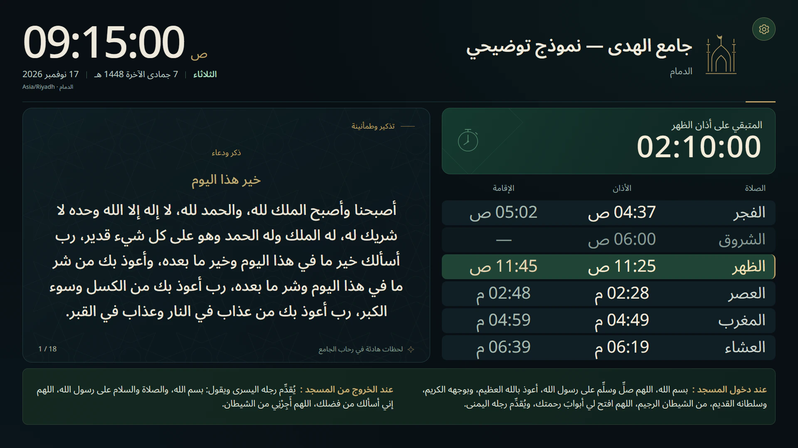
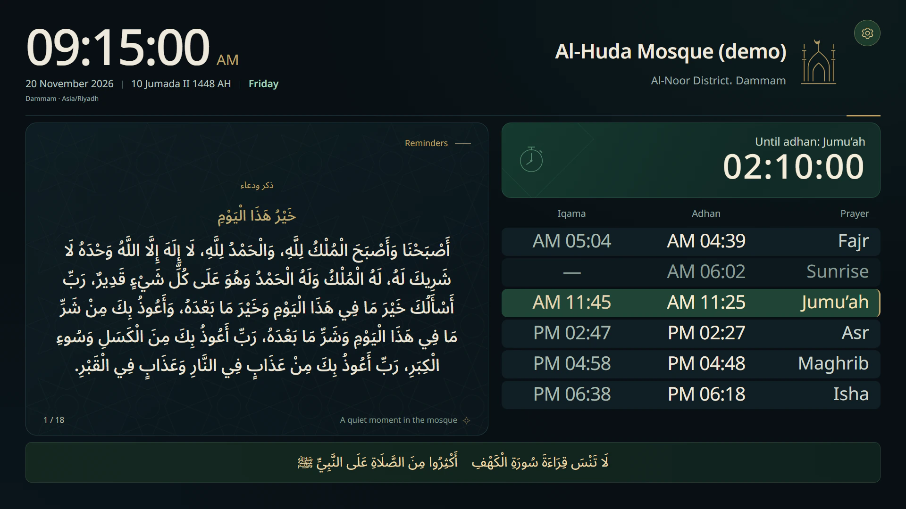
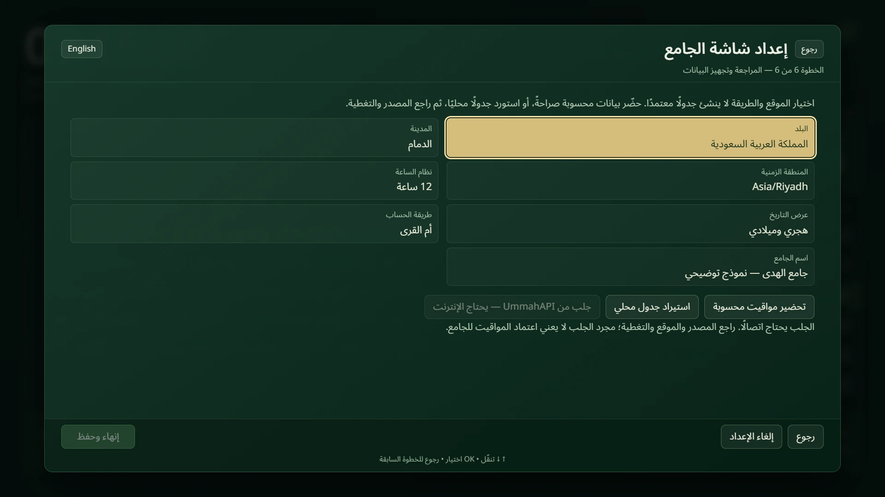
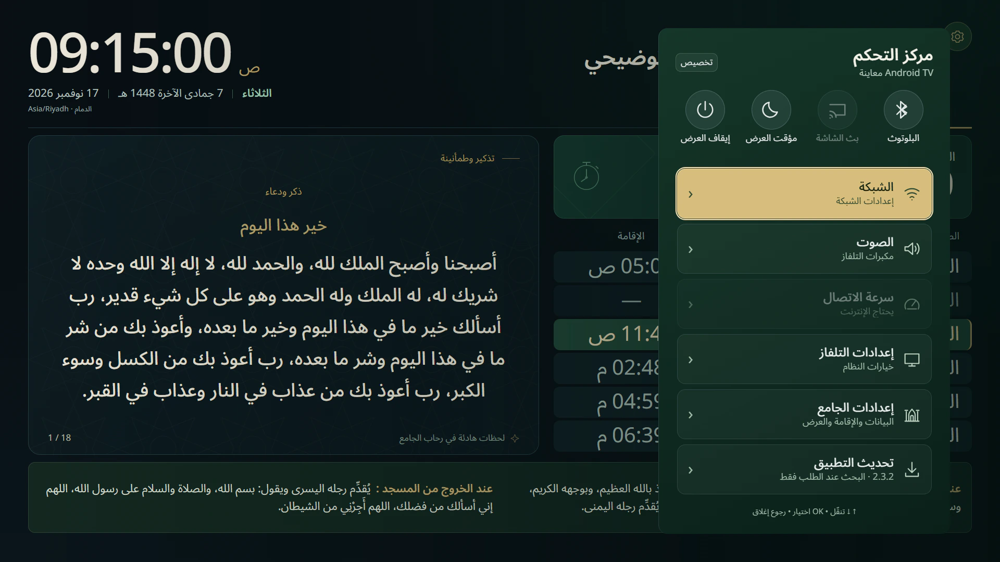

# شاشة الجامع · Mosque TV

**مواقيت الصلاة والإقامة والأذكار على شاشة جامعك.**

Prayer times, iqama countdowns, and adhkar for your mosque display.

[**العربية**](README.md) · [**English**](README_EN.md)

<strong>التثبيت الأول على التلفاز</strong>

افتح <a href="https://github.com/adel2184/mosque-tv/releases/latest">صفحة إصدارات شاشة الجامع الرسمية</a> وتحقق من اسم المشروع <code>adel2184/mosque-tv</code>، ثم اختر <code>mosque-display-tv.apk</code>. إذا تعذّر فتح GitHub على التلفاز، نزّل الملف على الكمبيوتر واتبع خطوات التثبيت بالفلاشة أدناه.

**[تنزيل التطبيق APK](https://github.com/adel2184/mosque-tv/releases/latest/download/mosque-display-tv.apk) · [خطوات التثبيت](#install) · [جميع الإصدارات](https://github.com/adel2184/mosque-tv/releases)**

شاشة الجامع تطبيق لأجهزة **Android TV وGoogle TV المتوافقة**، يعرض مواقيت الصلاة والعد إلى الأذان والإقامة والتاريخ الهجري والميلادي، مع أذكار وإعلانات يضبطها مشرف الجامع. تتحكم به بالريموت، وتختار العربية أو الإنجليزية للإعدادات وواجهة العرض. يعمل الإعداد بالحساب المحلي والعرض اليومي **دون إنترنت** بعد التثبيت. التطبيق صامت.

[المزايا](#features) · [صور التطبيق](#screenshots) · [التثبيت](#install) · [الإعداد](#setup) · [التحديث](#updates) · [الأسئلة الشائعة](#faq) · [الأدلة](#guides)

## ما الذي يقدمه؟

| للاستخدام اليومي | للمشرف |
| --- | --- |
| مواقيت الصلوات والعد إلى الأذان ثم الإقامة | إعداد أولي من ست خطوات بالعربية أو الإنجليزية |
| دعاء الدخول وتنبيه صامت قبل الإقامة، ثم شاشة الصلاة وأذكار ما بعدها ودعاء الخروج | مدة الصلاة، وتشغيل تنبيه الجوالات، ومدة عرض الأذكار |
| ساعة وتاريخ هجري وميلادي، وتذكير الجمعة وعدّاد الإفطار والفجر في رمضان | اسم الجامع وبياناته والإعلانات والحقول الإضافية |
| 18 ذكرًا ونصًا دينيًا بالعربية | إظهار بطاقة تبرع وQR بعد إعدادها؛ مخفية في التثبيت الجديد |
| عرض محلي بلا إعلانات داخل التطبيق | تصدير الإعدادات والمواقيت واستيرادها بصيغة JSON |
| دليل محلي يضم 244 بلدًا وإقليمًا و34,247 مدينة | مركز تحكم بالريموت، وربط هاتف مؤقت عبر الشبكة المحلية |

تتوفر أيضًا جداول لساعات العرض، واختصارات لإعدادات التلفاز، وتهيئة اختيارية للجهاز، وتحديثات وتقارير مشاكل بطلب المشرف. تعتمد وظائف النظام على الجهاز والصلاحيات. [دليل التلفاز](android/README_TV_AR.md).

في **2.4.0** يعمل هذا العرض من ساعة الجهاز وجدول الجامع دون إنترنت. اضبط التنبيه ومدة الأذكار من **مركز التحكم ← إعدادات الجامع ← العرض والأرقام**. تظهر الأدعية والأذكار بالعربية في اللغتين. [توقيت البطاقات ومراجعها](README_AR.md#prayer-guide)

## صور التطبيق

<table>
<tr>
<td width="50%"> <strong>واجهة بالإنجليزية</strong> المواقيت والساعة وأدوات العرض؛ تبقى الأذكار بالعربية.</td>
<td width="50%"> <strong>مراجعة الإعداد</strong> المكان والمنطقة الزمنية وطريقة الحساب قبل تجهيز الجدول.</td>
</tr>
<tr>
<td> <strong>مركز التحكم</strong> وصول إلى إعدادات الجامع وأدوات الجهاز بالريموت.</td>
<td> <strong>وضع الصلاة</strong> عبارة واضحة على خلفية سوداء عند الإقامة.</td>
</tr>
</table>

الصور معاينات فعلية لواجهة المصدر 2.3.2 داخل المتصفح ببيانات توضيحية؛ خيارات Android في صورة مركز التحكم ممثلة للمراجعة، وليست صورًا ملتقطة من التلفاز. اضغط الصورة لعرضها بحجم أكبر.

## التثبيت: اختر مسارك

| المسار | ما تحتاج إليه | ابدأ من هنا |
| --- | --- | --- |
| **Android TV / Google TV** | Android 7 أو أحدث، وWebView متوافق، وريموت | [الإصدار الرسمي للتلفاز](https://github.com/adel2184/mosque-tv/releases/latest) |
| **كمبيوتر أو معاينة بالمتصفح** | متصفح حديث ونسخة المصدر؛ Node.js للبناء الأول | [دليل التطوير والتشغيل](docs/DEVELOPMENT.md) ثم [دليل نسخة المتصفح](README_AR.md) |

### على التلفاز

**لتحديث نسخة سبق التحقق منها على التلفاز**، افتح «الإصدار والتحديثات» ثم «التحقق من تحديث التطبيق». وإذا استخدمت الرمز `1062755` في Downloader، فتحقق من أن صفحة الإصدار تخص المشروع `adel2184/mosque-tv`. أبقِ النسخة الحالية مثبّتة ليتمكن Android من مقارنة التوقيعين.

**بالفلاشة أو نقل الملفات:**

1. نزّل **`mosque-display-tv.apk`** من [صفحة الإصدار الرسمي](https://github.com/adel2184/mosque-tv/releases/latest)، أو استخدم ملف إصدار محلي موقّع بشهادة التطبيق الأصلية.
2. انقل الملف بفلاشة USB، وافتحه على التلفاز عبر مدير ملفات يدعم تثبيت APK. يمكنك أيضًا استخدام وسيلة نقل ملفات تثق بها.
3. إذا طلب Android إذن تثبيت تطبيقات من هذا المصدر، اسمح به لمدير الملفات المستخدم وأكمل نافذة التثبيت.
4. عند وجود إصدار سابق، اختر «تحديث» وأبقِ التطبيق وبياناته. عند التثبيت لأول مرة، افتح **شاشة الجامع** من قائمة التطبيقات وأكمل الإعداد أدناه. يمكنك بعدها فصل الفلاشة.

**التحقق من نسخة الفلاشة.** على Windows، افتح PowerShell في مجلد التنزيل وشغّل `Get-FileHash .\mosque-display-tv.apk -Algorithm SHA256`. طابق الأحرف الـ64 مع بصمة APK في `SHA256SUMS.txt` المرفق بنفس حزمة التوزيع. إذا اختلفت البصمة، احصل على نسخة سليمة قبل التثبيت.

إذا استلمت الملف من شخص آخر، يستطيع الفني التحقق من هوية الموقّع باستخدام أدوات بناء Android. يشغّل `apksigner verify --print-certs mosque-display-tv.apk` ويتحقق من نجاح الأمر ومن مطابقة بصمة شهادة الموقّع الأصلية SHA-256 للقيمة `4cb9564d63fd3f037d12e2ed98af1bf7255a7fb7ef53d6a57aba020b5e9b061e`.

**لديك نسخة سابقة؟** ثبّت التحديث فوقها، مع الاحتفاظ بالتطبيق وبياناته. صدّر نسخة احتياطية من الإعدادات إن أمكن. إذا رفض Android التحديث، راجع مصدر الملف والتوقيع قبل أي إزالة للتطبيق.

حزمة APK مخصصة لأجهزة Android المتوافقة؛ أجهزة Samsung بنظام Tizen وLG بنظام webOS تحتاج حلولًا أخرى. [التوافق والأسئلة الشائعة](#faq).

## الإعداد لأول مرة

1. **اللغة:** العربية أو English.
2. **المكان:** اختر البلد والمدينة من الدليل المحلي.
3. **العرض:** راجع المنطقة الزمنية، واختر شكل الساعة والتاريخ.
4. **الحساب:** اختر طريقة حساب المواقيت المناسبة لموقعك.
5. **بيانات الجامع:** أدخل الاسم والحي.
6. **المراجعة:** اختر **تحضير مواقيت محسوبة** للحساب المحلي دون إنترنت، أو استيراد JSON، أو جلب UmmahAPI الاختياري عند الاتصال، ثم جهّز الجدول واختر **إنهاء وحفظ**.

**قبل اعتماد الشاشة:** راجع ساعة الجهاز ومواقيت الصلاة وفواصل الإقامة وموعد الجمعة مع إدارة الجامع. المواقيت محسوبة، وتحتاج مراجعة؛ اختيار اسم طريقة حساب لا يجعلها جدولًا رسميًا. يجهز الإعداد السنة الحالية والتالية.

للتفاصيل: [دليل الإعداد بالعربية](docs/SETUP_AR.md) · [English setup guide](docs/SETUP_EN.md).

### التحكم بالريموت

| الزر | الوظيفة |
| --- | --- |
| الأسهم | التنقل بين العناصر |
| OK | الاختيار أو فتح محرر القيمة |
| رجوع / Back | الرجوع أو إلغاء التحرير أو إغلاق اللوحة |
| الترس أعلى الشاشة | فتح مركز التحكم؛ يظهر خارج وضع الصلاة |
| MENU، إذا أرسله الريموت | اختصار لفتح المركز |

امسح رمز الاقتران من مركز التحكم وطابق الرقم على الهاتف والتلفاز، ثم وافق بريموت التلفاز. افتح **الإعدادات** على الهاتف لتعديل اسم الجامع والحي، وترتيب إعلانات الشريط، ومواقيت الصلاة والإقامة، والساعة والتاريخ والتنبيهات. تظل التغييرات مسودة على الهاتف حتى تضغط **حفظ وتطبيق على الشاشة**. يتوفر الريموت وإرسال النص في تبويب **الريموت**. استخدم شبكة المشرفين الخاصة، فالاتصال المحلي عبر HTTP. [دليل مركز التحكم](docs/CONTROL_CENTER_AR.md)

## التحديث مع الاحتفاظ بالإعدادات

من **الإصدار والتحديث** اختر **البحث عن تحديث التطبيق**. عند جاهزية الإصدار اختر **تنزيل التحديث وتثبيته**، ثم وافق في نافذة Android. يحتاج البحث والتنزيل إلى اتصال مؤقت بالإنترنت.

تثبيت 2.5.1 فوق 2.5.0 يحفظ بيانات الجامع وجدول مواقيته. يعرض محدّث التلفاز أحدث إصدار منشور. [الإصدارات الرسمية](https://github.com/adel2184/mosque-tv/releases/latest) · [تقرير التحقق](android/TEST_REPORT_TV.md)

## أسئلة شائعة

**هل يحتاج الإنترنت؟** 
الحساب المحلي والإعداد والعرض اليومي لا تحتاج إليه. تنزيل التطبيق والتحديثات، وجلب UmmahAPI، واختبار السرعة وإرسال تقرير مشكلة تحتاج اتصالًا عند اختيارها. ربط الهاتف يحتاج شبكة محلية مشتركة فقط.

**هل الواجهة إنجليزية بالكامل؟** 
تتوفر الإنجليزية للواجهة والإعدادات والساعة وأسماء الصلوات. تبقى الأذكار والنصوص الدينية بالعربية، والنصوص التي تدخلها بلغتها الأصلية.

**هل يشغّل صوت الأذان؟** 
التطبيق صامت؛ يعرض المواقيت والعد التنازلي ووضع الصلاة بصريًا.

**هل يعمل على كل تلفاز ذكي؟** 
يلزم Android TV أو Google TV متوافق مع Android 7+ وWebView مناسب. توجد تجارب موثقة على TCL، ولا يعني ذلك اختبار جميع الطرز. البدء بعد إعادة التشغيل أو انقطاع الكهرباء يعتمد على الجهاز وإعداداته. [نتائج TCL](docs/TCL_TEST_RESULTS_AR.md).

**هل مؤقت العرض يطفئ التلفاز؟** 
يُظهر السواد داخل التطبيق؛ لا يطفئ لوحة التلفاز. إعدادات الطاقة الأصلية تتبع إمكانات الجهاز.

**المواقيت أو التاريخ غير صحيحين، ماذا أفعل؟** 
تحقق من ساعة الجهاز والمدينة والمنطقة الزمنية وطريقة الحساب، ثم راجع الجدول مع إدارة الجامع. لإعادة الإعداد: إعدادات الجامع ← المواقيت والتقويم ← إعداد الموقع واللغة والتقويم. صدّر نسخة احتياطية قبل تغيير إعداد قائم.

**هل تُرسل بيانات الجامع تلقائيًا؟** 
العرض والبيانات محلية. الإبلاغ عن مشكلة اختياري بعد معاينة النص ومراجعته والموافقة والتأكيد؛ التنقيح الآلي يحتاج مراجعتك. [تفاصيل خدمة التقارير](services/reports/README.md).

## الأدلة والمساهمة

| الدليل | المحتوى |
| --- | --- |
| [الإعداد: العربية](docs/SETUP_AR.md) · [English](docs/SETUP_EN.md) | خطوات البداية ومصادر المواقيت |
| [دليل التلفاز](android/README_TV_AR.md) · [دليل المتصفح](README_AR.md) | التشغيل والنسخ الاحتياطي والتخصيص |
| [مركز التحكم](docs/CONTROL_CENTER_AR.md) · [تهيئة الجهاز](docs/DEVICE_PREPARATION_AR.md) | الريموت والهاتف والطاقة والخيارات المتقدمة |
| [مصادر البيانات](DATA_SOURCES.md) · [المكان والتقويم](docs/LOCATION_SOURCES_AR.md) | الحساب والمراجع والتراخيص |
| [التحقق على التلفاز](android/TEST_REPORT_TV.md) · [الملاحظات الفنية](docs/PROJECT_NOTES_AR.md) | النتائج وحدود الاختبار وتفاصيل الإصدارات |
| [التطوير / Development](docs/DEVELOPMENT.md) · [المساهمة / Contributing](CONTRIBUTING.md) | البناء والتحقق والمشاركة |

لبلاغ أو اقتراح، افتح [Issue](https://github.com/adel2184/mosque-tv/issues) بالعربية أو الإنجليزية، واذكر الإصدار وطراز التلفاز وخطوات المشكلة بعد حذف المعلومات الخاصة. يمكنك أيضًا استخدام الإبلاغ الاختياري داخل التطبيق.

تراخيص المكونات والبيانات والخط محفوظة في [licenses](licenses/) و[assets/fonts](assets/fonts/) و[إسناد Android](android/SOURCES_LICENSES.md). لا يوجد حاليًا ترخيص عام مستقل لشيفرة المشروع؛ تراخيص المكونات تخص أصحابها.

---

اللهم اجعل هذا العمل صدقةً جاريةً عني وعن أهلي ووالديَّ، وانفع به، وتقبّله منا.

