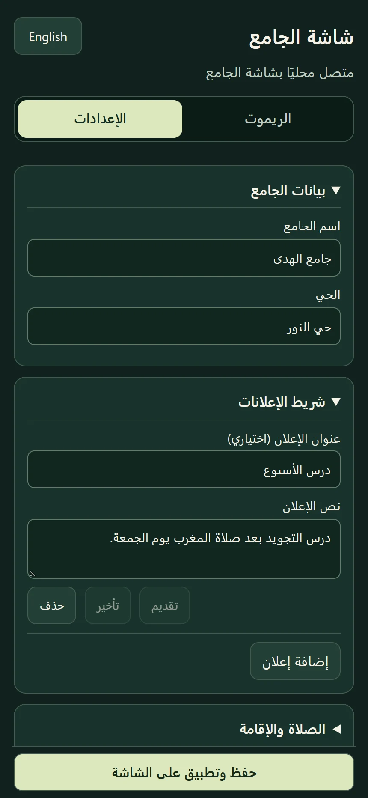

# 🕌 شاشة الجامع · Mosque TV

**حوّل تلفزيون المسجد إلى لوحة مواقيت وأذكار ذكية تعمل 100% دون إنترنت**

**Turn your mosque's TV into a smart, 100% offline prayer times & adhkar display**

  
  
  
  

  <a href="#install">التثبيت السريع</a> ·
  <a href="#features">المزايا</a> ·
  <a href="#phone">التحكم من الجوال</a> ·
  <a href="#setup">الإعداد</a> ·
  <a href="#english">English</a> ·
  <a href="#support">ادعم المشروع</a>

---

## 💡 وش فكرة «شاشة الجامع»؟

تطبيق صامت ومجاني وخالٍ من الإعلانات التجارية لأجهزة **Android TV وGoogle TV**، صُمّم لشاشات المساجد والمصليات.

* **العرض اليومي دون إنترنت.** يحسب التطبيق المواقيت محليًا ويعرض التقويم الهجري والأذكار ومراحل الصلاة من ساعة الجهاز وجدول الجامع.
* **تحديث من داخل التطبيق.** وصّل التلفزيون بالإنترنت مؤقتًا لتنزيل التحديث، ثم وافق على تثبيته ليبقى جدول جامعك وإعداداته محفوظين.
* **تحكّم بالريموت أو الجوال.** امسح رمز الاقتران ووافق بريموت التلفزيون، ثم استخدم جوالك للتنقل أو الكتابة أو تعديل الإعدادات.

> 🖼️ تعرض اللقطات واجهة **شاشة الجامع v2.5.1** في المتصفح ببيانات جامع توضيحية، مع محاكاة خيارات Android في مركز التحكم. يمكنك التبديل بين العربية والإنجليزية مع بقاء الأذكار والآيات بالعربية. اضغط على صورة لتكبيرها. [لقطة تعديل الإعدادات من الجوال](#phone-settings-preview)

| الشاشة الرئيسية صباح الجمعة | وضع الصلاة وتنبيه الجوالات | مركز التحكم الجانبي |
| :---: | :---: | :---: |
|  |  |  |

---

## ⚡ التثبيت على التلفزيون أو الكمبيوتر

| الطريقة | وش تحتاج؟ | ابدأ من هنا |
| :--- | :--- | :--- |
| **① من التلفزيون مباشرة** | تلفزيون متوافق، ريموت واتصال مؤقت بالإنترنت | [رمز Downloader](#downloader) |
| **② عبر فلاشة USB** | فلاشة وكمبيوتر أو جوال لتنزيل الملف | [تعليمات USB](#usb) |
| **③ معاينة على الكمبيوتر** | متصفح حديث ونسخة الويب | [فتح نسخة المتصفح](#desktop) |

### ① التثبيت من التلفزيون مباشرة (عبر Downloader)

1. افتح متجر التطبيقات في التلفزيون وحمّل تطبيق **Downloader** (أيقونته برتقالية).
2. افتح **Downloader** واكتب **`1062755`** ثم اضغط **Go**. تأكّد أن الوجهة المعروضة هي ملف `mosque-display-tv.apk` في مستودع `adel2184/mosque-tv` على GitHub.
3. بعد التنزيل اضغط **تثبيت (Install)**. إذا طلب Android إذن التثبيت من هذا المصدر، امنحه لتطبيق Downloader.
4. افتح تطبيق **«شاشة الجامع»** وأكمل خطوات الإعداد البسيطة.

### ② التثبيت عبر فلاشة USB

1. حمّل ملف **`mosque-display-tv.apk`** من [صفحة آخر إصدار](https://github.com/adel2184/mosque-tv/releases/latest).
2. انقله إلى فلاشة USB ووصّلها بالتلفزيون، ثم افتحه بمدير ملفات يدعم تثبيت APK. إذا طلب Android إذن التثبيت، اسمح به لمدير الملفات وأكمل التثبيت.

### ③ المعاينة على الكمبيوتر

إذا نزّلت المصدر من GitHub، شغّل `node dev/build.cjs` من مجلد المشروع باستخدام Node.js 24 أو 26 لتجهيز دليل المدن. ثم افتح `index.html` في المتصفح وأبقِ مجلد `assets/` بجانبه. إذا كانت لديك حزمة ويب مجهّزة، افتح الملف مباشرة. [دليل التشغيل والتطوير](docs/DEVELOPMENT.md)

### 🔄 عندك نسخة سابقة؟

من **مركز التحكم ← الإصدار والتحديث** اختر **البحث عن تحديث التطبيق** ثم **تنزيل التحديث وتثبيته**. اختر **تحديث** في نافذة Android. تثبيت النسخة الموقّعة فوق التطبيق الحالي يحفظ إعدادات الجامع ومواقيته وإعلاناته.

للتحقق من ملف **v2.5.1** (رمز الإصدار **15**)، حجمه **1,649,258 بايت** وبصمة SHA-256 له `e0b6cce341cc9b725a71bb79629bbc9d2acab1529d0a63a9691484e1c8aa5fa4`. على Windows احسبها بالأمر `Get-FileHash .\mosque-display-tv.apk -Algorithm SHA256`، وقارنها بسطر التطبيق في ملف البصمات المرفق بالإصدار الذي نزّلته. [ملفات v2.5.1](https://github.com/adel2184/mosque-tv/releases/tag/v2.5.1) · [دليل التثبيت والتوقيع](android/INSTALL_AR.txt)

---

## ✨ وش يقدّم لك البرنامج؟

### 🕌 للمصلين في المسجد

* **مواقيت الصلاة والعد التنازلي:** ساعة رقمية واضحة، التاريخ الهجري (أم القرى) والميلادي، والعد التنازلي للأذان ثم للإقامة.
* **أدعية الدخول والخروج تلقائيًا:**
  * يبرز **دعاء دخول المسجد** (*«اللَّهُمَّ افْتَحْ لِي أَبْوَابَ رَحْمَتِكَ»*) في الفترة ما بين الأذان والإقامة.
  * يعرض **دعاء الخروج من المسجد** (*«اللَّهُمَّ إِنِّي أَسْأَلُكَ مِنْ فَضْلِكَ»*) مع تذكير بالهدوء وتفقّد الأغراض لعشر دقائق بعد انتهاء الأذكار، أو بعد انتهاء وضع الصلاة إذا عطّلت شاشة الأذكار.
* **تنبيه إغلاق الجوالات.** في آخر دقيقتين قبل الإقامة وأول عشر ثوانٍ من وضع الصلاة، يظهر تنبيه **«الرجاء إغلاق الجوالات أو وضعها على الصامت»**.
* **وضع الصلاة «أقيموا صفوفكم»:** عند الإقامة تتحول الشاشة إلى خلفية سوداء مريحة للعين بعبارة **«أقيموا صفوفكم»** بخط كبير وواضح.
* **شاشة أذكار ما بعد الصلاة.** عند انتهاء وضع الصلاة، تعرض الشاشة الأذكار بخط كبير لمدة خمس دقائق تلقائيًا. يمكنك اختيار 3 أو 5 أو 7 دقائق أو إيقافها من **إعدادات الجامع ← العرض والأرقام**.
* **وضع يوم الجمعة ورمضان الذكي:**
  * **يوم الجمعة:** تذكير بقراءة **سورة الكهف** والإكثار من **الصلاة على النبي ﷺ** من الفجر حتى أذان الجمعة، وعبارة **«أنصتوا رحمكم الله»** وقت الخطبة.
  * **شهر رمضان:** عدّاد إضافي واضح لوقت **الإفطار (المغرب)** ووقت **الإمساك/الفجر**.

### 🛠️ لإمام المسجد والمشرف

* يضم **دليل المدن المدمج** 244 بلدًا وإقليمًا و34,247 مدينة للحساب الفلكي المحلي دون إنترنت.
* **تخصيص كامل:** تعديل اسم الجامع، دقائق الإقامة لكل صلاة، وقت صلاة الجمعة، مدة وضع الصلاة، وشريط الإعلانات والتنبيهات.
* **الطاقة وساعات الراحة.** يمكن إبقاء الشاشة مضاءة أثناء عرض التطبيق أو تحديد ساعات راحة ليلية يظهر فيها السواد. يتبع إطفاء اللوحة ومؤقّتاتها إعدادات جهازك.
* **بطاقة تبرع اختيارية.** تبدأ مخفية عند التثبيت الأول. تحقّق من وجهة رمز QR المرفق قبل إظهاره للمصلّين، فتعديل نص البطاقة وحده يُبقي وجهة الرمز كما هي.
* **نسخ احتياطي واستعادة بصيغة JSON.** صدّر إعدادات الجامع لاستعادتها لاحقًا. لنقل جدول الصلاة أيضًا، استخدم **تصدير جدول المواقيت** واحفظ ملفه مع نسخة الإعدادات. [دليل النسخ والاستعادة](README_AR.md)

---

## 📱 التحكم من الجوال (عبر الباركود)

ما يحتاج تتعب في الكتابة بالريموت!

1. اضغط **OK** على أيقونة الترس أعلى الشاشة لفتح **مركز التحكم**، أو اضغط `MENU` إذا كان الريموت يدعمه. اختر **«التحكم من الجوال»**.
2. صِل الجوال والتلفزيون بشبكة محلية خاصة بالمشرفين أو بنقطة اتصال مشتركة، ثم امسح **الباركود (QR)**. يكفي الاتصال المحلي.
3. طابق الرقم المكوّن من ست خانات على الجوال والتلفزيون، ثم وافق بريموت التلفزيون. اختر أحد التبويبين في متصفح الجوال.

   * **الريموت** للتنقل بالأسهم وإرسال النص من لوحة مفاتيح الجوال.
   * **الإعدادات** لتعديل الاسم والحي، وإضافة إعلانات الشريط وترتيبها، وضبط المواقيت والإقامة والساعة والتنبيهات، وتصدير نسخة من الإعدادات أو استعادتها.

4. اختر **حفظ وتطبيق على الشاشة** لإرسال التعديلات دفعة واحدة. ينتهي الاتصال عند إغلاق نافذة الاقتران على التلفزيون أو انتهاء مهلة الجلسة. [دليل التحكم من الجوال](docs/CONTROL_CENTER_AR.md)

  

---

## 🚀 الإعداد لأول مرة (6 خطوات بسيطة)

عند تشغيل التطبيق لأول مرة، أكمل الخطوات الست بالريموت.

1. **اللغة:** اختر **العربية** أو **English**.
2. **المكان:** اختر بلدك ومدينتك من الدليل المحلي.
3. **العرض:** راجع المنطقة الزمنية وشكل الساعة (12/24 ساعة) والتاريخ.
4. اختر **طريقة حساب المواقيت** المناسبة لموقعك، مثل أم القرى.
5. **بيانات الجامع:** اكتب اسم الجامع والحي.
6. **المراجعة والحفظ.** اختر **«تحضير مواقيت محسوبة»** لتجهيز السنة الحالية والتالية دون إنترنت. راجع الأوقات مع إدارة الجامع، ثم اضغط **«إنهاء وحفظ»**. يمكنك أيضًا استيراد جدول JSON محلي أو طلب جدول من UmmahAPI عند الاتصال.

---

## ❓ أسئلة شائعة

<b>هل يحتاج التطبيق إلى إنترنت ليعمل يوميًا؟</b>

 
يعمل الحساب الفلكي والتقويم الهجري والأذكار والتنبيهات <b>دون إنترنت</b>. يلزم الاتصال عند تنزيل التطبيق أو تحديثه، أو عند اختيار خدمة مثل جلب المواقيت من UmmahAPI أو إرسال تقرير مشكلة.

<b>هل يصدر التطبيق صوت أذان؟</b>

 
لا، التطبيق <b>صامت تمامًا</b> ليتناسب مع طبيعة المساجد؛ يعتمد على العرض البصري الواضح والتنبيهات النصية.

<b>هل يعمل على جميع الشاشات الذكية؟</b>

 
يحتاج ملف APK إلى تلفزيون أو صندوق <b>Android TV أو Google TV بنظام Android 7.0 أو أحدث</b> وWebView متوافق. يمكن توصيل صندوق Android TV بشاشة Samsung التي تعمل بنظام Tizen أو LG التي تعمل بنظام webOS.

<b>تلفزيوني يطفى من حاله بعد ساعات، وش الحل؟</b>

 
راجع خيار إبقاء الشاشة مضاءة وساعات الراحة في إعدادات التطبيق. ثم افحص مؤقت النوم وخيار الإيقاف عند عدم النشاط في إعدادات طاقة التلفزيون نفسه.

---

## 🌐 English Overview

**Mosque TV (شاشة الجامع)** is a silent, ad-free prayer display for compatible Android TV and Google TV devices. Daily operation and local setup work **entirely offline**.

* **Offline Prayer Engine:** Built-in database of 244 countries/territories and 34,247 cities with local astronomical calculation and Umm al-Qura Hijri calendar.
* **Smart Mosque Lifecycle:** Displays Entrance Dua between Adhan & Iqama, a 2-minute pre-Iqama silent-phone reminder, high-contrast *"Straighten your rows"* prayer screen, customizable Post-Prayer Adhkar screen, Exit Dua, plus automatic Friday (Jumu'ah) and Ramadan countdown modes.
* **QR mobile controls.** Connect both devices to a trusted local network, scan the QR code, compare the six digits and approve with the TV remote. Use your phone as a remote or edit announcements, prayer times and settings, then tap **Save & Apply to TV**.
* **Quick install.** Open **Downloader** on the TV and enter **`1062755`**, or download the signed APK from the [latest release](https://github.com/adel2184/mosque-tv/releases/latest). To keep your settings and timetable, update the installed app in place. [Full English guide](README_EN.md)

---

## 📚 الأدلة الفنية والمساهمة

* 📖 [دليل الإعداد بالعربية](docs/SETUP_AR.md) · [English Setup Guide](docs/SETUP_EN.md)
* 🎛️ [شرح مركز التحكم](docs/CONTROL_CENTER_AR.md) · [تهيئة الجهاز والطاقة](docs/DEVICE_PREPARATION_AR.md)
* 🔬 [تقرير الاختبارات والأمان والأداء](TEST_REPORT.md) · [مصادر البيانات والتراخيص](DATA_SOURCES.md)
* 📺 [دليل التلفزيون](android/README_TV_AR.md) · [دليل المتصفح](README_AR.md) · [مراجع الأدعية وتوقيت عرضها](README_AR.md#prayer-guide)

---

## 🙏 ادعم المشروع

* ⭐ **ضع نجمة (Star) على هذا المستودع** ليصل إلى أكبر عدد من القائمين على المساجد والمطورين.
* 🐛 **الإبلاغ عن الأخطاء.** واجهت مشكلة على طراز تلفزيون معين؟ اذكر طراز التلفزيون ورقم الإصدار وخطوات ظهور المشكلة في [بلاغ جديد](https://github.com/adel2184/mosque-tv/issues/new).
* 💡 **اقتراح ميزات:** شاركنا أفكارك لتطوير شاشات المساجد.
* 🤝 **ساهم في كتابة الكود.** نرحب بمساهمتك. [دليل المساهمة](CONTRIBUTING.md) · [طلبات الدمج](https://github.com/adel2184/mosque-tv/pulls)
* 📢 **شارك مع الآخرين:** انشر المشروع لأئمة ومؤذني المساجد والمشرفين عليها.

---

### 🤲 اللهم اجعل هذا العمل صدقةً جاريةً عني وعن أهلي ووالديَّ، وانفع به، وتقبّله منا.

