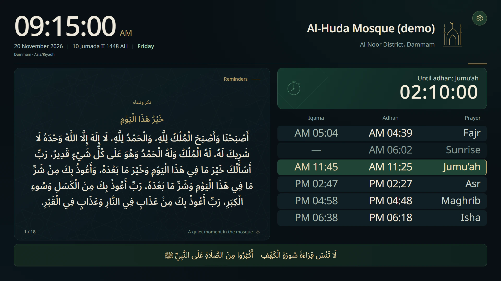
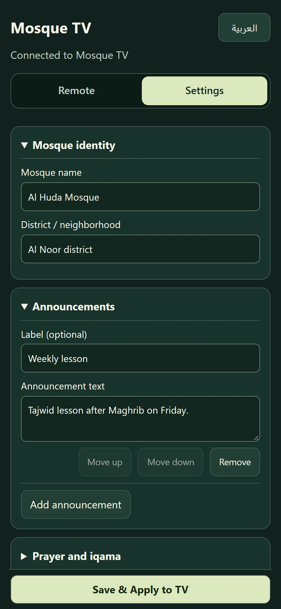

# 🕌 Mosque TV · شاشة الجامع

**Turn your mosque’s TV into an offline display for prayer times and adhkar.**

**حوّل تلفزيون المسجد إلى لوحة مواقيت وأذكار ذكية تعمل 100% دون إنترنت**

  
  
  
  

  <a href="#install">Quick install</a> ·
  <a href="#features">Features</a> ·
  <a href="#phone">Phone controls</a> ·
  <a href="#setup">First-time setup</a> ·
  <a href="#english">Overview</a> ·
  <a href="#support">Support the project</a> ·
  <a href="README.md" lang="ar">العربية</a>

---

## 💡 What is Mosque TV?

Mosque TV is a free, silent app for **Android TV and Google TV** in mosques and prayer rooms. It runs without commercial advertising.

* **Use it offline.** The app calculates prayer times locally and shows the Hijri date. It uses the device clock and the mosque’s saved timetable to show the right reminder before, during and after each prayer.
* **Update from the TV.** Connect briefly to download an update, then approve installation on the TV. Your settings and prayer timetable carry over.
* **Use a remote or a phone.** Scan the pairing code and approve with the TV remote. You can then use your phone to navigate, type or edit settings.

**Friday program.** Nine Arabic reminders rotate from local sunrise until 11 AM. A full-screen khutbah reminder lasts until Jumu’ah iqama. Staff can change the times and prayer duration under **Mosque settings → Friday program**.

> 🖼️ These browser captures show **Mosque TV v2.5.1** with a sample mosque profile and simulated Android options in the control centre. You can switch the interface between English and Arabic. Duas, adhkar and Qur’anic verses stay in Arabic. Select an image to enlarge it. [Phone settings screenshot](#phone-settings-preview)

| Friday morning display | Prayer mode and phone reminder | Control centre (Arabic) |
| :---: | :---: | :---: |
|  |  |  |

---

## ⚡ Install on a TV or preview on a computer

| Method | What you need | Start here |
| --- | --- | --- |
| **① Install directly on the TV** | A compatible TV, its remote and a temporary internet connection | [Downloader code](#downloader) |
| **② Install from USB** | A USB drive and a computer or phone to download the APK | [USB instructions](#usb) |
| **③ Preview on a computer** | A modern browser and a copy of the web app | [Desktop instructions](#desktop) |

### ① Install directly on the TV with Downloader

1. Open the TV’s app store and install **Downloader** (the orange icon).
2. In **Downloader**, enter **`1062755`** and press **Go**. Check that the destination shown is `mosque-display-tv.apk` in the `adel2184/mosque-tv` GitHub repository.
3. After the download, select **Install**. If Android asks for permission to install apps from this source, grant it to Downloader.
4. Open **Mosque TV (شاشة الجامع)** and complete the setup steps.

### ② Install from a USB drive

1. Download **`mosque-display-tv.apk`** from the [latest GitHub release](https://github.com/adel2184/mosque-tv/releases/latest).
2. Copy the APK to the USB drive, plug it into the TV and open the file with a file manager that supports APK installation. If Android asks for permission, grant it to that file manager and complete installation.

### ③ Preview on a computer

If you downloaded the source from GitHub, use Node.js 24 or 26 to run `node dev/build.cjs` from the project folder. This prepares the offline city catalog. Open `index.html` in your browser with the `assets/` folder beside it. If you already have a prepared web bundle, open `index.html` directly. [Development and preview guide](docs/DEVELOPMENT.md)

### 🔄 Already have Mosque TV installed?

Open **Control centre → Version and updates**. Select **Check for an app update**, then **Download and install update**. Choose **Update** in the Android prompt. Installing the signed update over the existing app keeps your mosque settings, prayer timetable and announcements.

The signed **v2.5.2** APK (`versionCode 17`) is **1,657,450 bytes**. Its SHA-256 digest is `004b0c5cefca889edd4c9e6aa9e7a5e44cf9dcb65d79129c986b2e849c53ec81`. To verify a download on Windows, run `Get-FileHash .\mosque-display-tv.apk -Algorithm SHA256` and compare the result with the APK entry in `SHA256SUMS.txt` from the same release. [v2.5.2 release files](https://github.com/adel2184/mosque-tv/releases/tag/v2.5.2) · [Installation and signing guide (Arabic)](android/INSTALL_AR.txt)

---

## ✨ What does the app show?

### 🕌 For worshippers

* The **clock and prayer timetable** show the Hijri date (Umm al-Qura), the Gregorian date and a countdown to the adhan, then to the iqama.
* **Duas for entering and leaving the mosque** appear at the corresponding times.
  * Between adhan and iqama, the screen highlights the entrance dua **«اللَّهُمَّ افْتَحْ لِي أَبْوَابَ رَحْمَتِكَ»**.
  * For ten minutes after the post-prayer adhkar, it shows the exit dua **«اللَّهُمَّ إِنِّي أَسْأَلُكَ مِنْ فَضْلِكَ»** with a reminder to leave quietly and check your belongings. If the adhkar screen is off, the ten minutes start when prayer mode ends.
* **“Please silence or turn off your mobile phones”** appears during the final two minutes before iqama and the first ten seconds of prayer mode.
* **At iqama**, the screen turns black and shows **«أقيموا صفوفكم»** (“Straighten your rows”) in large lettering.
* **After prayer mode**, the screen displays large Arabic adhkar for five minutes by default. In **Mosque settings → Display and digits**, set **Post-prayer adhkar duration** to **Off**, **3**, **5** or **7** minutes.
* **Friday and Ramadan** have their own reminders.
  * On Fridays, from Fajr until the Jumu’ah adhan, the screen reminds worshippers to read Surah Al-Kahf and send blessings upon the Prophet ﷺ. During the khutbah, it shows **«أنصتوا رحمكم الله»** (“Listen attentively, may Allah have mercy on you”).
  * In Ramadan, a second countdown shows the time until **iftar (Maghrib)** during the day and **imsak (Fajr)** at night.

### 🛠️ For the imam and mosque administrators

* The **offline city catalog** covers **244 countries and territories** and **34,247 cities** for local prayer-time calculation.
* **Mosque settings** let you edit the mosque name, iqama intervals for each prayer, Friday prayer time, prayer-mode duration, scrolling announcements and alerts.
* **Display and power settings** can keep the screen awake while the app is visible or show a black screen during scheduled quiet hours. The TV’s power settings govern panel shutoff and sleep timers.
* The **optional donation card** starts hidden on a new installation. The donation destination is encoded in the QR image itself. Check where the code leads before displaying the card to worshippers.
* **JSON backups** let you export and restore mosque settings. To move the prayer timetable as well, choose **Export timetable** and keep that separate file with the settings backup. [Backup and restore guide (Arabic)](README_AR.md)

---

## 📱 Control the TV from your phone

Use your phone’s keyboard to enter text or edit an announcement.

1. Select the gear at the top of the TV screen and press **OK** to open **Control centre**, or press `MENU` if your remote supports it. Choose **Phone control**.
2. Connect the phone and TV to the same private staff network or hotspot, then scan the on-screen **QR code**. A local connection is enough.
3. Check that the same six digits appear on both screens, then approve with the TV remote. Choose a tab in your phone’s browser.

   * **Remote** has the direction buttons and lets you send text from your phone keyboard.
   * **Settings** lets you edit the mosque name and neighbourhood, add or reorder announcements, adjust prayer and iqama times, set the clock format and alerts, and export or restore a settings backup.

4. Tap **Save & Apply to TV** to send the changes together. The session ends when you close the pairing window on the TV or when the session times out. [Phone controls guide (Arabic)](docs/CONTROL_CENTER_AR.md)

  

---

## 🚀 First-time setup in six steps

On first launch, use the TV remote to complete the setup wizard.

1. Choose **Arabic** or **English** for the interface.
2. Select your **country and city** from the offline catalog.
3. Check the **time zone** and choose the 12- or 24-hour clock and date display.
4. Select the **prayer-time calculation method** appropriate to your location, such as Umm al-Qura.
5. Enter the **mosque name and neighbourhood**.
6. Choose **Prepare calculated times** to build the timetable for the current and following year offline. Review the times with the mosque administration, then select **Finish and save**. You can also import a local JSON timetable or request one from UmmahAPI when online.

---

## ❓ Frequently asked questions

<b>Does the display need internet every day?</b>

 
Prayer-time calculation, the Hijri calendar, adhkar and reminders all work offline. Connect to download or update the app, or when you choose an online service such as importing times from UmmahAPI or sending a problem report.

<b>Does it play the adhan?</b>

 
Mosque TV is silent. The prayer timetable, countdowns and reminders appear on screen.

<b>Which smart TVs can run it?</b>

 
The APK needs an Android TV or Google TV device running Android 7.0 or later with a compatible WebView. For a Samsung TV running Tizen or an LG TV running webOS, you can connect a compatible Android TV box.

<b>My TV turns off after a few hours. What should I check?</b>

 
Check the app’s keep-screen-on setting and quiet hours. Then check the sleep timer and automatic shutoff for inactivity in the TV’s own power settings.

---

## 🌐 Mosque TV at a glance

Mosque TV is a silent, ad-free display for Android TV and Google TV. Local setup and daily use work entirely offline.

* The bundled city catalog covers 244 countries and territories and 34,247 cities. The app calculates prayer times locally and uses the Umm al-Qura Hijri calendar.
* Worshippers see the entrance dua, the two-minute phone reminder, the “Straighten your rows” screen, post-prayer adhkar and the exit dua. Friday reminders and Ramadan countdowns appear automatically.
* On a shared local network, scan the QR code, compare the six digits and approve with the remote. Use your phone to navigate or edit mosque settings, then tap **Save & Apply to TV**.
* For a first installation, enter **`1062755`** in Downloader or get the signed APK from the [latest release](https://github.com/adel2184/mosque-tv/releases/latest). To keep your settings and timetable, update the installed app in place. [النسخة العربية](README.md)

---

## 📚 Guides and contributing

* 📖 [Setup guide in Arabic](docs/SETUP_AR.md) · [Setup guide in English](docs/SETUP_EN.md)
* 🎛️ [Control centre (Arabic)](docs/CONTROL_CENTER_AR.md) · [Device preparation and power (Arabic)](docs/DEVICE_PREPARATION_AR.md)
* 🔬 [Testing, security and performance report (Arabic)](TEST_REPORT.md) · [Data sources and licenses](DATA_SOURCES.md)
* 📺 [TV guide (Arabic)](android/README_TV_AR.md) · [Browser guide (Arabic)](README_AR.md) · [Sources and display times for the duas (Arabic)](README_AR.md#prayer-guide)

---

## 🙏 Support the project

* ⭐ **Star the repository** to help other mosque administrators and developers find it.
* 🐛 **Report a bug** with your TV model, app version and the steps that led to the problem. [Open an issue](https://github.com/adel2184/mosque-tv/issues/new)
* 💡 **Suggest a feature** that would help people run displays in their mosques.
* 🤝 **Contribute code.** [Contribution guide](CONTRIBUTING.md) · [Pull requests](https://github.com/adel2184/mosque-tv/pulls)
* 📢 **Share Mosque TV** with imams, muezzins and the people who look after mosque displays.

---

### 🤲 اللهم اجعل هذا العمل صدقةً جاريةً عني وعن أهلي ووالديَّ، وانفع به، وتقبّله منا.

May Allah accept this work as an ongoing charity on behalf of me, my family and my parents, and make it beneficial to others.

