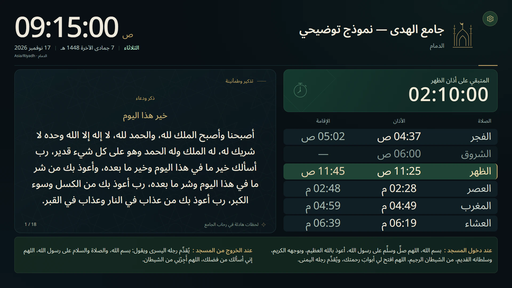
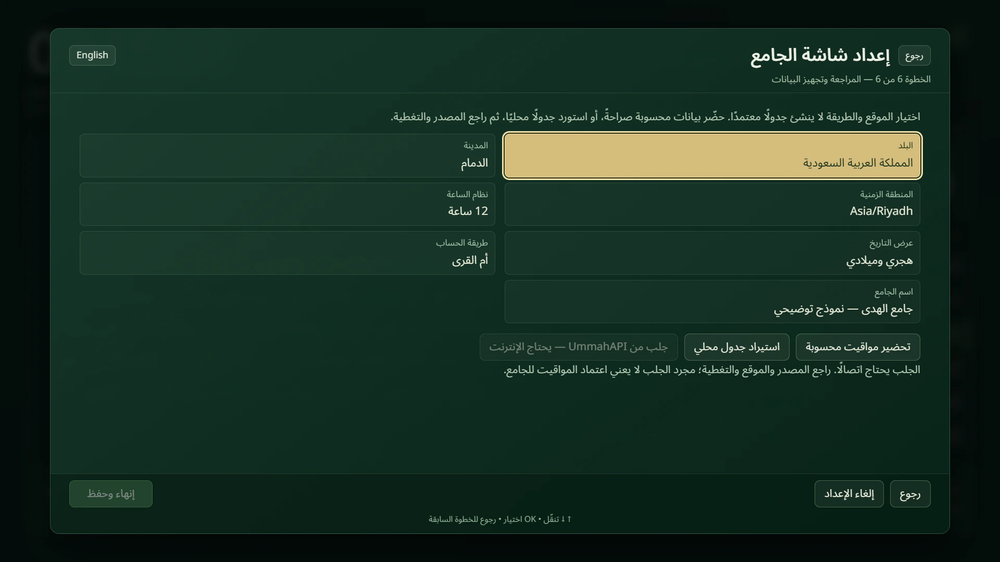
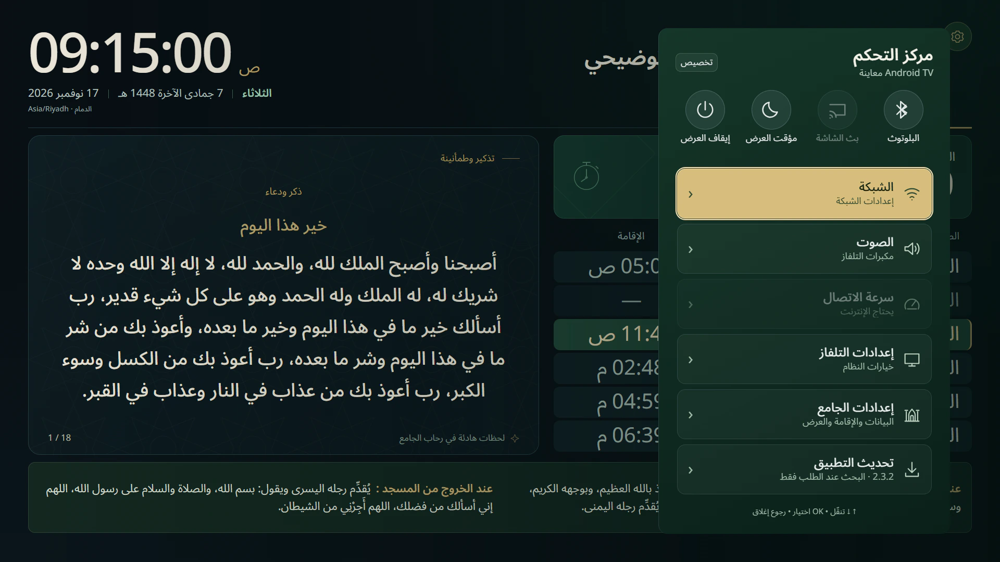

# Mosque TV · شاشة الجامع

**Prayer times, iqama countdowns, and adhkar for your mosque display.**

مواقيت الصلاة والإقامة والأذكار على شاشة جامعك.

[**العربية**](README.md) · [**English**](README_EN.md)

<strong>First installation on your TV</strong>

Open the <a href="https://github.com/adel2184/mosque-tv/releases/latest">official Mosque TV release page</a> from the project owner, <code>adel2184/mosque-tv</code>. Choose <code>mosque-display-tv.apk</code>. If browsing GitHub is difficult on the TV, download on a computer and follow the USB instructions below.

**[Download APK](https://github.com/adel2184/mosque-tv/releases/latest/download/mosque-display-tv.apk) · [Installation](#install) · [All releases](https://github.com/adel2184/mosque-tv/releases)**

Mosque TV turns a compatible **Android TV or Google TV** into a mosque display with prayer times, adhan and iqama countdowns, Hijri and Gregorian dates, adhkar, and announcements. Use your TV remote to configure it in Arabic or English. Local calculation, initial setup, and everyday display work **without internet** after installation. The app is silent.

[Features](#features) · [Screenshots](#screenshots) · [Install](#install) · [Setup](#setup) · [Updates](#updates) · [FAQ](#faq) · [Guides](#guides)

## What it offers

| On the display | For the administrator |
| --- | --- |
| Prayer times, followed by adhan and iqama countdowns | Six-step setup in Arabic or English |
| Mosque entrance dua, silent phone reminder, prayer screen, post-prayer adhkar and exit dua | Custom iqama times, Friday schedule and reminder settings |
| Clock, Hijri and Gregorian dates, Friday reminders and Ramadan countdown | Mosque details, announcements and extra text fields |
| 18 Arabic adhkar and religious texts | Optional donation card and QR image; hidden on a fresh install |
| Local display with no in-app advertising | JSON settings and timetable import and export |
| Offline catalog of 244 countries and territories and 34,247 cities | Remote-friendly control center and temporary phone pairing on your LAN |

Additional tools include display schedules, TV settings shortcuts, optional device preparation, updates, and problem reports initiated by the administrator. System features depend on your TV and its permissions. See the [TV guide (Arabic)](android/README_TV_AR.md).

### The prayer display in 2.4.0

1. From adhan to iqama the display highlights the mosque entrance dua. A phone reminder appears during the final two minutes and the first ten seconds of “Straighten your rows.”
2. When prayer mode ends, large Arabic adhkar cards take over for five minutes by default. Choose Off, 3, 5 or 7 minutes.
3. The clock and timetable return with the exit dua and a reminder to leave quietly and check belongings for ten minutes. With the adhkar screen off, these ten minutes start at the end of prayer mode. The next adhan takes precedence whenever it begins.
4. On Friday, reminders to read Surah Al-Kahf and send blessings upon the Prophet ﷺ run from Fajr until the timetable’s Friday Dhuhr adhan. The reminder to listen then lasts through Friday prayer mode. During Ramadan, a second countdown targets Maghrib for iftar by day and Fajr for imsak by night. After the final Ramadan sunset, the label reads “Fajr”. The bundled Umm al-Qura calendar follows the mosque’s local civil date.

Both settings are in **Control centre → Mosque settings → Display and digits**. The phone reminder is on by default. The saved timetable, mosque time zone, device clock and bundled religious texts supply the whole sequence offline. Titles and instructions follow the chosen language. The duas and adhkar stay in Arabic.

Sources for the entrance and exit duas, the prayers after salām, the count of 33 and Ayat al-Kursi are available for reference. [Sahih Muslim 713a](https://sunnah.com/muslim:713a) · [591](https://sunnah.com/muslim:591) · [597a](https://sunnah.com/muslim:597a) · [Qur’an 2:255](https://quran.com/2/255)

## Screenshots

<table>
<tr>
<td width="50%"> <strong>Arabic display</strong> Prayer times, clock, countdown, and religious reminders.</td>
<td width="50%"> <strong>Review your setup</strong> Check location, time zone, and calculation preset before preparation.</td>
</tr>
<tr>
<td> <strong>Control centre</strong> Reach mosque settings and device tools with the remote.</td>
<td> <strong>Prayer mode</strong> A clear message against a black background at iqama.</td>
</tr>
</table>

These are browser previews of the actual 2.3.2 source UI using demonstration data. Android options in the control-center image are simulated for preview; these are not captures from a physical TV. Click any image to enlarge it.

## Install: choose your path

| Path | Requirements | Start here |
| --- | --- | --- |
| **Android TV / Google TV** | Android 7+, a compatible WebView, and a remote | [Official APK release](https://github.com/adel2184/mosque-tv/releases/latest) |
| **Computer or browser preview** | A modern browser and the source; Node.js for the initial build | [Build and run guide](docs/DEVELOPMENT.md), with [detailed browser instructions (Arabic)](README_AR.md) |

### On your TV

**On a TV that already has a verified copy:** use **Version and updates → Check for an app update**. If using Downloader code `1062755`, confirm the release belongs to `adel2184/mosque-tv`. Keep the existing app installed so Android can compare signatures.

**Using a USB drive or file transfer:**

1. Download **`mosque-display-tv.apk`** from the [official release page](https://github.com/adel2184/mosque-tv/releases/latest), or use a local release APK signed with the application’s original certificate.
2. Copy the APK to a USB drive and open it on the TV with a file manager that supports APK installation. You can also use a file-transfer method you trust.
3. If Android asks, allow installation from the file manager you are using and complete the system installation dialog.
4. On an existing installation, choose **Update** and keep the app and its data in place. For a first installation, open **شاشة الجامع / Mosque TV** from the apps list and complete setup below. You can then remove the USB drive.

**Checking a USB copy.** On Windows, open PowerShell in the download folder and run `Get-FileHash .\mosque-display-tv.apk -Algorithm SHA256`. Compare all 64 characters with the APK entry in `SHA256SUMS.txt` supplied with that exact distribution. If they differ, obtain a fresh copy before installation.

If someone supplied the APK separately, your technician can also verify its identity with Android SDK Build Tools. Run `apksigner verify --print-certs mosque-display-tv.apk` and check for a successful exit and the original signer certificate SHA-256 `4cb9564d63fd3f037d12e2ed98af1bf7255a7fb7ef53d6a57aba020b5e9b061e`.

**Already installed?** Install the update over the existing app, keeping its data. Export a settings backup if possible. If Android rejects the update, check the download source and signing certificate before considering any uninstall.

The APK is for compatible Android devices. Samsung Tizen and LG webOS need other solutions. See [compatibility and FAQ](#faq).

## First-time setup

1. **Language:** choose Arabic or English.
2. **Location:** select your country and city from the offline catalog.
3. **Display:** check the time zone and choose clock and date formats.
4. **Calculation:** choose a prayer-time calculation preset for your location.
5. **Mosque details:** enter the mosque name and neighborhood.
6. **Review:** choose **Prepare calculated times** for offline calculation, import a JSON timetable, or optionally download from UmmahAPI while online. Prepare the timetable, then select **Finish and save**.

**Before using it in your mosque:** check the device clock, prayer times, iqama intervals, and Friday schedule with the mosque administration. Times are calculated and need review; a named calculation preset does not make them an official timetable. Setup prepares the current and following year.

The [English setup guide](docs/SETUP_EN.md) covers every step and timetable source. [دليل الإعداد بالعربية](docs/SETUP_AR.md).

### Remote controls

| Button | Action |
| --- | --- |
| Arrow keys | Move between items |
| OK | Select an item or edit a value |
| Back | Go back, cancel editing, or close the panel |
| On-screen gear | Open the control center; hidden during prayer mode |
| MENU, if sent by your remote | Shortcut to the control center |

Open **Control centre → Mosque settings** to edit directly with the remote.

On staff Wi-Fi, open phone pairing on the TV, scan the QR code and compare the six digits before approving with the physical remote. **Remote** keeps the D-pad and quick text controls. In **Settings**, edit the mosque identity, reorder ticker announcements, change iqama and date-specific prayer times, or adjust the clock, dates and alerts. The phone keeps a local draft until you choose **Save & Apply to TV**. You can also export or restore a settings JSON file. The connection uses local HTTP. Closing the TV pairing session disconnects the phone.

## Update while keeping settings

Open **Version and updates → Check for an app update**, download the release, and select **Install**. Complete Android's permission and installation prompts if requested. Updating requires a temporary internet connection; local display continues without internet. You can also install the new APK manually over the existing app.

Installing 2.5.1 over 2.5.0 retains your mosque profile and prayer timetable. The TV updater shows the latest published release. [Releases](https://github.com/adel2184/mosque-tv/releases/latest) · [Verification report (Arabic)](android/TEST_REPORT_TV.md)

## Frequently asked questions

**Does it need internet?** 
Offline calculation, setup, and everyday display do not. Downloading the app or updates, fetching from UmmahAPI, running a speed test, or sending a problem report requires internet when you choose that action. Phone pairing needs only a shared local network.

**Is the interface fully English?** 
English is available for the interface, settings, clock, and prayer names. Adhkar and religious texts remain in Arabic. Text you enter keeps its original language.

**Does it play the adhan?** 
The app is silent. Prayer times, countdowns, and prayer mode are visual.

**Will it work on every smart TV?** 
It needs compatible Android TV or Google TV with Android 7+ and a suitable WebView. Some TCL behavior is documented; this is not verification of every model. Starting after a reboot or power failure depends on the TV and its configuration. [TCL results (Arabic)](docs/TCL_TEST_RESULTS_AR.md).

**Does the display timer turn off the TV?** 
It shows black inside the app; it does not power off the physical panel. Native power behavior depends on the device.

**What if the times or date are wrong?** 
Check the device clock, city, time zone, and calculation preset. Review the timetable with mosque staff. To run setup again, open Mosque settings → Timetable and calendar → Set up location, language and calendar. Export a backup before changing an existing configuration.

**Are mosque details sent automatically?** 
The display and its data are local. Problem reports are optional and require a local preview, review, consent, and final confirmation. Review the text even after automatic redaction. [Reporting-service details (Arabic)](services/reports/README.md).

## Guides and contributions

| Guide | What it covers |
| --- | --- |
| [English setup](docs/SETUP_EN.md) · [الإعداد بالعربية](docs/SETUP_AR.md) | First launch and timetable sources |
| [Development](docs/DEVELOPMENT.md) · [Contributing](CONTRIBUTING.md) | Build, verify, and contribute |
| [TV guide](android/README_TV_AR.md) · [Browser guide](README_AR.md) — Arabic | Operation, customization, and backups |
| [Control centre](docs/CONTROL_CENTER_AR.md) · [Device preparation](docs/DEVICE_PREPARATION_AR.md) — Arabic | Remote, phone, power, and advanced tools |
| [Data sources](DATA_SOURCES.md) · [Location and calendar](docs/LOCATION_SOURCES_AR.md) — Arabic | Calculation, references, and component licenses |
| [TV verification](android/TEST_REPORT_TV.md) · [Technical notes](docs/PROJECT_NOTES_AR.md) — Arabic | Results, test limits, and release details |

For a bug or suggestion, open an [issue](https://github.com/adel2184/mosque-tv/issues) in English or Arabic. Include the version, TV model, and reproduction steps after removing private information. Optional in-app reporting is also available.

Component, data, and font licenses are preserved in [licenses](licenses/), [assets/fonts](assets/fonts/), and [Android attribution](android/SOURCES_LICENSES.md). The project code currently has no separate overall license; component licenses apply to their respective authors' work.

---

May Allah accept this work as an ongoing charity (sadaqah jariyah) on behalf of me, my family, and my parents, and make it beneficial to others.

اللهم اجعل هذا العمل صدقةً جاريةً عني وعن أهلي ووالديَّ، وانفع به، وتقبّله منا.

